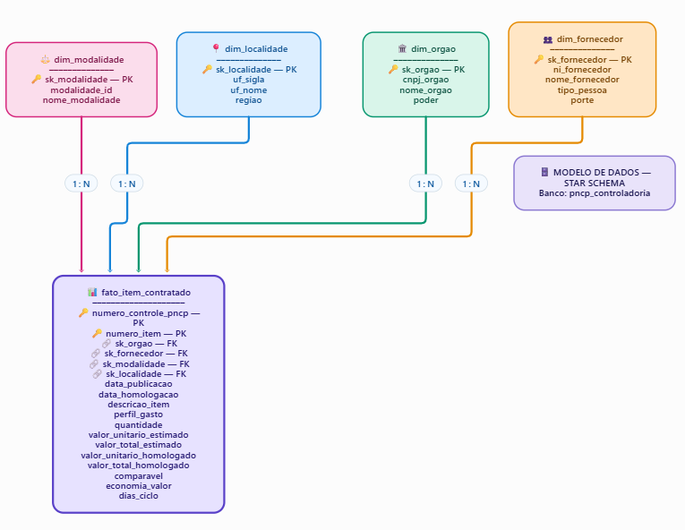
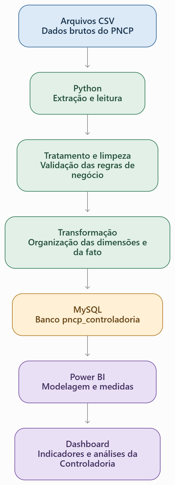

# Controladoria PNCP

**Projeto Final — Módulo 2 | Análise de Dados**
**Instituição:** SENAI
**Aluna:** Tais Cristina Tagliani Doico
**Ano:** 2026

---

## **1. Apresentação**

O projeto Controladoria PNCP foi desenvolvido com o objetivo de analisar dados de contratações públicas e transformar essas informações em indicadores que facilitem a compreensão e o acompanhamento dos gastos públicos.

A ideia foi desenvolver uma solução completa de análise de dados, desde a preparação e organização das informações até a criação de um dashboard interativo no Power BI.

Durante o desenvolvimento, utilizei Python para o tratamento dos dados, MySQL para armazenar e organizar as informações e Power BI para construir as análises e apresentar os resultados de forma visual.

## **2. Contexto e problema**

Ao iniciar este projeto, meu desafio foi trabalhar com uma grande quantidade de dados de contratações públicas e encontrar uma maneira de transformar essas informações em algo mais organizado, claro e útil para análise.

Percebi que, antes de construir os indicadores, era necessário entender os dados, identificar inconsistências, definir critérios de tratamento e organizar as informações de maneira adequada.

A partir disso, desenvolvi um processo que permite analisar diferentes aspectos das contratações, como valores estimados e homologados, fornecedores, modalidades, economia potencial, distribuição regional e perfil dos gastos.

## **3. Tecnologias utilizadas**

Durante o desenvolvimento do projeto, utilizei diferentes ferramentas e tecnologias, cada uma com uma função específica:

- **Python:** utilizado para auditoria, limpeza e tratamento dos dados.
- **MySQL e MySQL Workbench:** utilizados para gerenciamento do banco de dados, armazenamento das informações e execução de consultas SQL.
- **Power BI:** utilizado para desenvolver o dashboard interativo e apresentar os indicadores.
- **Git e GitHub:** utilizados para controle de versão e armazenamento do projeto.

## **4. Tratamento e preparação dos dados**

Nesta etapa, utilizei Python e a biblioteca Pandas para analisar, limpar e organizar os dados antes de armazená-los no banco de dados.

O processo envolveu a identificação de inconsistências, padronização de informações, tratamento de valores e aplicação das regras de negócio definidas para o projeto.

Após essa preparação, os dados foram organizados em arquivos CSV, que serviram de base para a carga das informações no MySQL.

Também foram realizados testes de validação das regras de limpeza, com 54 exemplos testados e aprovados, garantindo que o tratamento dos dados estivesse funcionando conforme o esperado.

## **5. Modelagem e banco de dados**

Para organizar os dados e facilitar as consultas e análises, desenvolvi uma modelagem dimensional do tipo **Star Schema (Esquema Estrela)** no MySQL.

O modelo é composto por uma tabela Fato, que concentra as informações numéricas das contratações, e quatro tabelas Dimensão, que permitem analisar esses dados por diferentes perspectivas.

**Estrutura do banco de dados:**

- **Tabela Fato:** fato_item_contratado.
- **Tabelas Dimensão:** dim_orgao, dim_fornecedor, dim_modalidade e dim_localidade.
- **Calendário:** criado no Power BI utilizando DAX.

Essa estrutura permite relacionar as informações e explorar os dados de forma organizada, facilitando a construção dos indicadores e das análises no Power BI.

**Diagrama da modelagem:**

## **6. Fluxo de dados (Pipeline ETL)**

O projeto utiliza um processo de ETL (Extração, Transformação e Carga) desenvolvido em Python para processar os dados disponibilizados pelo PNCP.

Esse processo permite extrair os dados dos arquivos CSV, realizar a limpeza, validação e transformação das informações e, posteriormente, carregá-las no banco de dados MySQL (pmcp_controladoria).

Após essa etapa, os dados são disponibilizados para conexão com o Power BI, onde são desenvolvidos os indicadores, análises e dashboards da Controladoria.

**Etapas do fluxo de dados:**

- **Origem dos dados:** arquivos CSV do PNCP.
- **Processamento:** extração, limpeza, validação e transformação utilizando Python.
- **Armazenamento:** carga dos dados tratados no MySQL.
- **Visualização:** conexão com o Power BI para construção dos indicadores e dashboards.

Essa estrutura organiza o processamento dos dados desde sua origem até a apresentação das informações, permitindo análises mais consistentes e apoiando a tomada de decisão.

**Diagrama do fluxo de dados:**

