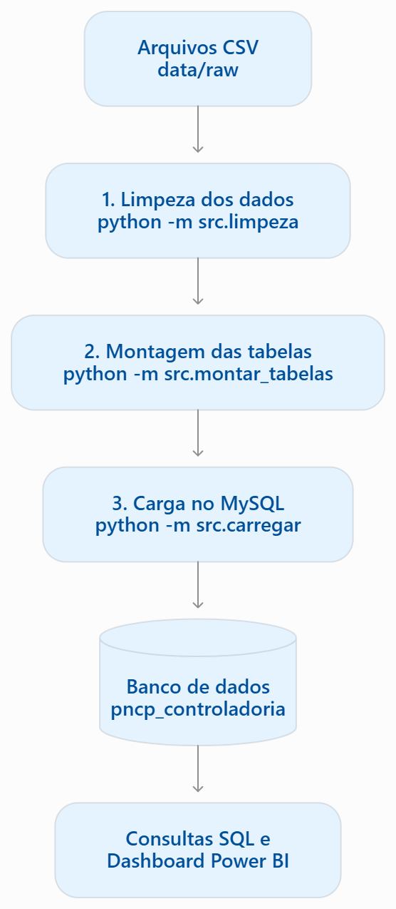
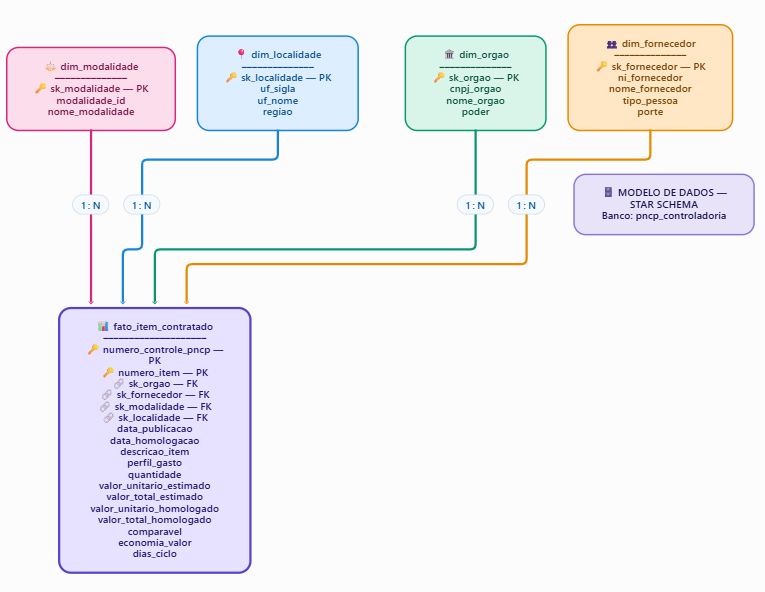
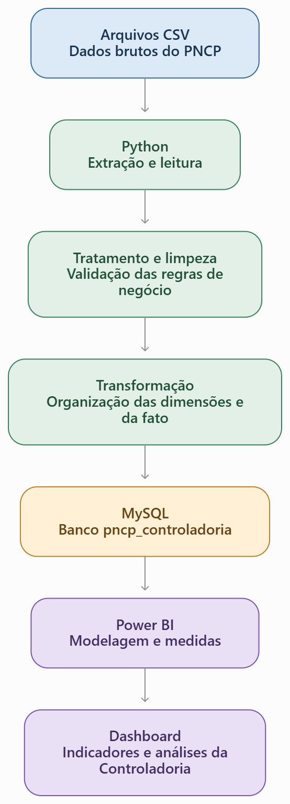
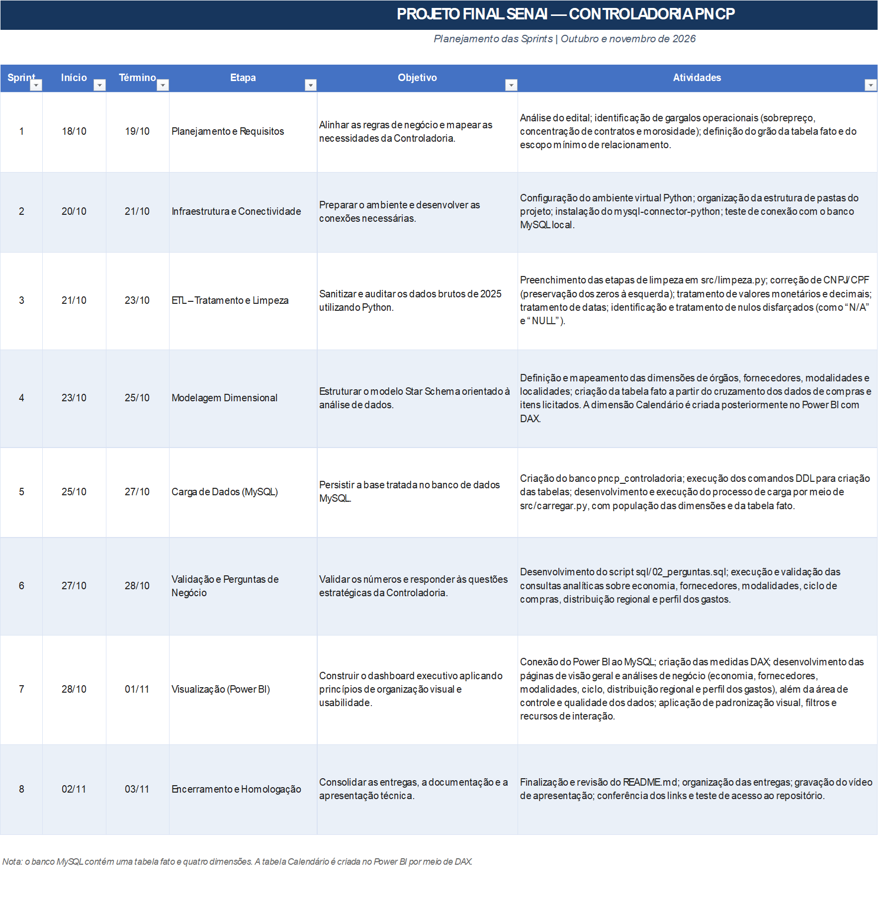

# Controladoria PNCP

**Projeto Final — Módulo 2 | Análise de Dados**
**Instituição:** SENAI
**Aluna:** Tais Cristina Tagliani Doico
**Ano:** 2026

---

## 1. Apresentação

O projeto Controladoria PNCP foi desenvolvido com o objetivo de analisar dados de contratações públicas e transformar essas informações em indicadores que facilitem a compreensão e o acompanhamento dos gastos públicos.

A proposta foi desenvolver uma solução completa de análise de dados, desde a preparação e organização das informações até a criação de um dashboard interativo no Power BI.

Durante o desenvolvimento, utilizei Python para o tratamento dos dados, MySQL para armazenar e organizar as informações e Power BI para construir as análises e apresentar os resultados de forma visual.

## 2. Contexto e problema

Ao iniciar este projeto, meu desafio foi trabalhar com uma grande quantidade de dados de contratações públicas e encontrar uma maneira de transformar essas informações em algo mais organizado, claro e útil para análise.

Percebi que, antes de construir os indicadores, era necessário entender os dados, identificar inconsistências, definir critérios de tratamento e organizar as informações de maneira adequada.

A partir disso, desenvolvi um processo que permite analisar diferentes aspectos das contratações, como valores estimados e homologados, fornecedores, modalidades, economia potencial, distribuição regional e perfil dos gastos.

O projeto foi orientado por seis perguntas de negócio:

1. Qual é o percentual e o valor financeiro nominal economizado pelo
   governo (diferença entre valor estimado e valor homologado)?
2. Quem são os maiores fornecedores em volume financeiro e qual percentual
   do orçamento público está concentrado neles?
3. Quais modalidades licitatórias trazem maior deságio/economia e quais
   concentram o maior volume de recursos?
4. Qual a duração média (em dias) entre o lançamento do edital e a sua
   homologação final, segmentada por órgão?
5. Quais estados e regiões concentram as maiores despesas e quais apresentam os melhores indicadores de desconto?
6. Como os recusrso se distribuem entre bens, serviços e obras e engenharia?

## 3. Fontes de dados e documentação

Os dados utilizados neste projeto foram disponibilizados pela professora como parte do material de referência para o desenvolvimento do projeto Controladoria PNCP.

O conjunto de dados é composto por três arquivos CSV:

- `compras.csv`
- `itens.csv`
- `resultados.csv`

Os arquivos contêm informações sobre contratações públicas e foram utilizados como base para as etapas de limpeza, transformação, modelagem e análise.

O período de publicação dos registros analisados em `compras.csv` compreende **2 de janeiro a 31 de dezembro de 2025**.

A documentação e as regras de negócio fornecidas para o projeto orientaram o tratamento dos dados, a construção das consultas SQL e o desenvolvimento dos indicadores apresentados no dashboard.

**Observação:** os arquivos CSV originais foram disponibilizados pela professora para fins acadêmicos e não foram incluídos no repositório GitHub. Os arquivos são mantidos localmente na pasta `data/raw/`.

## 4. Tecnologias utilizadas

Durante o desenvolvimento do projeto, utilizei diferentes ferramentas e tecnologias, cada uma com uma função específica:

- **Python:** utilizado para auditoria, limpeza e tratamento dos dados.
- **MySQL e MySQL Workbench:** utilizados para gerenciamento do banco de dados, armazenamento das informações e execução de consultas SQL.
- **Power BI:** utilizado para desenvolver o dashboard interativo e apresentar os indicadores.
- **Git e GitHub:** utilizados para controle de versão e armazenamento do projeto.

## 5. Estrutura do repositório

O projeto foi organizado em pastas para separar os dados, os scripts de processamento, as consultas SQL, os arquivos de visualização e a documentação.

```
Projeto-Final-Modulo-2/
│
├── .venv/
│
├── data/
│   ├── processed/
│   └── raw/
│
├── docs/
│   └── img/
│
├── powerbi/
│   └── Controladoria_PNCP.pbix
│
├── sql/
│   ├── 01_criar_banco.sql
│   └── 02_perguntas.sql
│
├── src/
│   ├── __init__.py
│   ├── config.py
│   ├── extracao.py
│   ├── limpeza.py
│   ├── montar_tabelas.py
│   └── carregar.py
│
├── .env
├── .gitignore
├── README.md
└── requirements.txt
```

**Descrição das pastas:**

- **.venv:** ambiente virtual do projeto, utilizado para gerenciar as dependências Python.
- **data/processed:** contém os arquivos CSV após o tratamento e a transformação dos dados.
- **data/raw:** armazena localmente os arquivos CSV originais utilizados no projeto.
- **docs/img:** reúne os diagramas, o planejamento das Sprints e as capturas das páginas do dashboard.
- **powerbi:** contém o arquivo do dashboard `Controladoria_PNCP.pbix`.
- **sql:** reúne os scripts de criação do banco de dados e as consultas SQL utilizadas para responder às perguntas de negócio.
- **src:** contém os scripts Python responsáveis pela extração, limpeza, transformação e carregamento dos dados.

**Arquivos principais:**

- **.env:** armazena as configurações e credenciais de conexão com o banco de dados.
- **.gitignore:** define os arquivos e pastas que não devem ser enviados ao GitHub.
- **README.md:** apresenta o projeto, seus objetivos, tecnologias, etapas de desenvolvimento e resultados.
- **requirements.txt:** lista as bibliotecas e dependências necessárias para executar o projeto.

## 6. Tratamento e preparação dos dados

Nesta etapa, utilizei Python e a biblioteca Pandas para analisar, limpar e organizar os dados antes de armazená-los no banco de dados.

O processo envolveu a identificação de inconsistências, padronização de informações, tratamento de valores e aplicação das regras de negócio definidas para o projeto.

Após essa preparação, os dados foram organizados em arquivos CSV, que serviram de base para a carga das informações no MySQL.

Também foram realizados testes de validação das regras de limpeza, com **54 exemplos testados e aprovados**, garantindo que o tratamento dos dados estivesse funcionando conforme o esperado.

**Diagrama do Pipeline ETL:**



## 7. Modelagem dimensional e banco de dados

Para organizar os dados e facilitar as consultas e análises, desenvolvi uma modelagem dimensional do tipo **Star Schema (Esquema Estrela)** no MySQL.

O modelo é composto por uma tabela Fato, que concentra as informações dos itens de contratação, e quatro tabelas Dimensão, que permitem analisar esses dados por diferentes perspectivas.

**Estrutura do banco de dados:**

- **Tabela Fato:** `fato_item_contratado`.
- **Tabelas Dimensão:** `dim_orgao`, `dim_fornecedor`, `dim_modalidade` e `dim_localidade`.
- **Calendário:** criado no Power BI utilizando DAX.

A tabela fato possui o grão de um item de contratação, identificado pela combinação do número de controle PNCP e do número do item.

Essa estrutura permite relacionar as informações e explorar os dados de forma organizada, facilitando a construção dos indicadores e das análises no Power BI.

**Diagrama da modelagem dimensional — Star Schema:**



## 8. Modelagem do fluxo de dados

O projeto utiliza um fluxo de dados que integra as diferentes ferramentas empregadas no processamento e na análise das informações.

Os arquivos CSV representam a origem dos dados. Em seguida, Python realiza a limpeza, validação e transformação das informações. Os arquivos tratados são organizados e carregados no banco de dados MySQL (`pncp_controladoria`), que disponibiliza as informações para conexão com o Power BI.

Essa integração permite acompanhar o caminho percorrido pelos dados, desde sua origem até a apresentação dos indicadores no dashboard.

**Diagrama do fluxo de dados:**



## 9. Como executar o projeto

Para reproduzir o projeto, são necessários Python, MySQL e as dependências especificadas no arquivo `requirements.txt`.

As etapas de execução são:

- **9.1. Preparação do ambiente:** clonar o repositório, criar e ativar o ambiente virtual e instalar as dependências.
- **9.2. Configuração do banco de dados:** configurar as credenciais de acesso ao MySQL e executar o script `sql/01_criar_banco.sql`, responsável pela criação do banco `pncp_controladoria`.
- **9.3. Execução do pipeline:** executar as etapas de limpeza e validação, montagem das tabelas dimensionais e da tabela fato e carregamento dos dados no MySQL.

As consultas desenvolvidas para responder às perguntas de negócio estão reunidas no arquivo `sql/02_perguntas.sql`.

## 10. Planejamento e execução do projeto

O desenvolvimento do projeto foi organizado em oito Sprints, permitindo dividir as atividades em etapas e acompanhar a evolução de cada fase, desde o planejamento inicial até a construção do dashboard e a finalização da solução.

Essa organização facilitou o acompanhamento das atividades e a evolução do projeto de forma estruturada.

**Cronograma das Sprints:**



## 11. Dashboard — Controladoria PNCP

O dashboard foi desenvolvido no Power BI com o objetivo de transformar os dados tratados e armazenados no MySQL em informações visuais que facilitem o acompanhamento das contratações públicas.

A solução foi organizada em **sete páginas temáticas**, permitindo explorar diferentes perspectivas dos dados:

- **Visão Geral:** apresenta os principais indicadores e uma visão consolidada das contratações.
- **Economia:** permite acompanhar a diferença entre valores estimados e homologados e analisar os indicadores de economia potencial.
- **Fornecedores:** apresenta a distribuição dos valores homologados e permite observar a participação e a concentração dos fornecedores.
- **Modalidades:** compara as modalidades de contratação considerando valores financeiros, quantidade de itens e indicadores de economia.
- **Ciclo:** permite acompanhar o intervalo entre a publicação e a homologação dos processos, identificando prazos e situações sem ciclo válido.
- **Regional:** apresenta a distribuição dos valores homologados e dos indicadores de economia entre as localidades e regiões.
- **Perfil de Gastos:** permite observar a distribuição dos gastos por perfil, incluindo obras e engenharia, serviços e bens, com valores e participação percentual.

O dashboard também conta com uma página de Tooltip, utilizada como recurso complementar para apresentar informações .

O relatório utiliza cartões, gráficos e tabelas para facilitar a interpretação dos indicadores e apoiar a análise dos dados.

O arquivo do relatório está disponível em:

`powerbi/Controladoria_PNCP.pbix`

As capturas das páginas do dashboard estão organizadas na pasta `docs/imagens/`.

## 12. Resultados do processamento

Após a execução do processo de tratamento, modelagem e carga dos dados, foram obtidos 6.126 registros na tabela fato `fato_item_contratado`, 363 registros na dimensão de órgãos, 2.652 na dimensão de fornecedores, 7 na dimensão de modalidades e 27 na dimensão de localidades.

A tabela fato foi validada, apresentando **6.126 registros e nenhuma duplicidade** na chave de negócio definida para o projeto.

Também foram realizados 54 testes de validação das regras de limpeza, todos executados com sucesso.

As consultas SQL desenvolvidas permitiram responder às seis perguntas de negócio propostas, explorando os dados sob diferentes perspectivas e alimentando as análises apresentadas no Power BI.

## 13. Principais insights

A análise dos dados permitiu identificar aspectos importantes das contratações públicas, respondendo às principais perguntas de negócio propostas para o projeto.

Entre os resultados observados, destacam-se:

- **Economia potencial:** foram identificados aproximadamente R$ 992,86 milhões em economia nominal, correspondentes a 14,46% na análise dos itens comparáveis. Esse indicador representa a diferença entre os valores estimados e homologados, respeitando os critérios de comparabilidade definidos no projeto.
- **Concentração de fornecedores:** os dez principais fornecedores representam 41,43% do valor homologado analisado. Esse resultado evidencia a importância de acompanhar a distribuição dos valores entre os fornecedores e observar possíveis concentrações nas contratações.
- **Modalidades de contratação:** o Pregão Eletrônico apresentou economia de aproximadamente 24,02% nos itens comparáveis. Já a Concorrência Eletrônica concentrou o maior volume financeiro homologado entre as modalidades analisadas.
- **Tempo do ciclo de contratação:** o tempo médio entre publicação e homologação válida foi de aproximadamente 48,1 dias, enquanto o maior intervalo identificado foi de 611 dias. Também foram identificados 230 itens sem ciclo válido, indicando situações que merecem acompanhamento.
- **Distribuição regional:** o Distrito Federal apresentou o maior volume financeiro homologado entre as localidades analisadas. A comparação dos percentuais de economia entre estados permite observar diferenças regionais e identificar oportunidades de investigação.
- **Perfil dos gastos:** as obras e engenharia representaram aproximadamente 60,82% do valor homologado, seguidas pelos serviços, com 36,56%, e pelos bens, com 2,63%.
- **Controle dos dados:** dos 6.126 itens analisados, 99 foram classificados como rejeitados conforme as regras de negócio. Além disso, 852 itens não possuíam resultado associado, situação que não foi automaticamente classificada como rejeição.

De forma geral, os resultados demonstram como a organização e a análise dos dados podem auxiliar a Controladoria a identificar padrões, acompanhar situações relevantes e direcionar investigações mais aprofundadas.

## 14. Conclusão e melhorias futuras

O projeto Controladoria PNCP permitiu transformar informações de contratações públicas em indicadores que podem apoiar o acompanhamento dos gastos e a tomada de decisão pela Controladoria.

A partir das seis perguntas de negócio definidas no início do projeto, foi possível identificar oportunidades de economia, observar a concentração dos valores entre fornecedores, comparar modalidades de contratação, acompanhar o tempo dos processos, analisar a distribuição regional dos recursos e compreender o perfil dos gastos públicos.

**O que as análises indicam para a gestão?**

- **Economia nas contratações:** os aproximadamente R$ 992,86 milhões de economia nominal identificados nos itens comparáveis representam uma oportunidade para acompanhar os resultados financeiros das contratações. A gestão pode utilizar essas informações para investigar órgãos e modalidades com melhores resultados e identificar processos que apresentem diferenças relevantes entre os valores estimados e homologados.
- **Concentração de fornecedores:** a participação de 41,43% dos dez maiores fornecedores no valor homologado indica a necessidade de acompanhar a distribuição das contratações. A análise por órgão e modalidade pode ajudar a identificar possíveis dependências e orientar ações para ampliar a competitividade.
- **Modalidades de contratação:** os resultados do Pregão Eletrônico e da Concorrência Eletrônica permitem comparar economia e volume financeiro. Essas informações podem apoiar o planejamento de futuras contratações e a avaliação das estratégias utilizadas pelos órgãos.
- **Tempo dos processos:** o tempo médio de 48,1 dias e os casos com intervalos elevados mostram a importância de acompanhar os prazos das contratações. Investigar os processos mais demorados pode ajudar a identificar gargalos administrativos e propor melhorias para tornar os procedimentos mais eficientes.
- **Distribuição regional:** a identificação das localidades com maior volume financeiro permite direcionar o acompanhamento dos recursos e aprofundar a investigação sobre diferenças nos resultados das contratações entre estados e regiões.
- **Perfil dos gastos:** a concentração de 60,82% do valor homologado em obras e engenharia demonstra a importância de acompanhar esse grupo de despesas, apoiando o planejamento orçamentário e a definição de prioridades de fiscalização.
- **Qualidade dos dados:** os 99 itens rejeitados, os 852 itens sem resultado associado e os 230 itens sem ciclo válido representam situações que merecem acompanhamento. A separação dessas ocorrências permite direcionar verificações específicas sem classificar automaticamente todos os registros incompletos como problemas ou irregularidades.

É importante destacar que indicadores de concentração, diferenças de valores ou inconsistências nos registros não comprovam, isoladamente, irregularidades, desperdícios ou favorecimentos. Eles representam sinais que podem orientar análises complementares e investigações mais aprofundadas.

**Melhorias futuras**

A partir dos resultados obtidos e das limitações identificadas durante a análise, algumas melhorias poderiam tornar a solução ainda mais completa e ampliar sua utilidade para a Controladoria.

**Análise dos dados**

- **Ampliar a base de dados:** incluir outros anos e contratações estaduais e municipais permitiria comparar os resultados e acompanhar como os gastos públicos evoluem ao longo do tempo.
- **Melhorar a comparação de preços:** padronizar as descrições e unidades dos itens ajudaria a comparar produtos e serviços equivalentes, permitindo identificar diferenças de preços que mereçam uma análise mais detalhada.
- **Aprofundar a análise dos fornecedores:** investigar os fornecedores que concentram os maiores valores homologados, considerando também os órgãos e as modalidades em que atuam, ajudaria a identificar situações que precisam de maior acompanhamento.
- **Aprimorar a classificação dos gastos:** ampliar os critérios utilizados para classificar bens, serviços e obras permitiria apresentar uma divisão mais precisa dos recursos públicos.
- **Completar informações dos fornecedores:** buscar informações cadastrais complementares, como o porte das empresas, permitiria entender melhor a distribuição das contratações entre empresas de diferentes tamanhos.
- **Aprimorar a análise regional:** utilizar o cadastro do órgão como referência para identificar sua localidade poderia reduzir ambiguidades encontradas na associação de CNPJs a diferentes unidades da Federação.
- **Identificar valores fora do padrão:** desenvolver indicadores para localizar itens com valores muito acima dos praticados em contratações de itens equivalentes ajudaria a direcionar análises e auditorias.

**Qualidade dos dados e processamento**

- **Corrigir inconsistências nas datas:** investigar os processos em que a homologação aparece antes da publicação e buscar a correção dessas informações junto aos órgãos responsáveis.
- **Ampliar as validações:** implementar novos testes automáticos para identificar erros e inconsistências sempre que os dados forem processados.
- **Automatizar o processamento:** integrar todas as etapas do pipeline para facilitar a execução e permitir que novas informações sejam incorporadas sem a necessidade de refazer todo o processo.
- **Facilitar a reprodução do projeto:** preparar um ambiente padronizado para que outros profissionais consigam executar o processamento e acessar os resultados com mais facilidade.

**Evolução do dashboard**

- **Ampliar os filtros de análise:** permitir que a Controladoria explore os indicadores por órgão, fornecedor, modalidade, região e perfil de gasto.
- **Melhorar a visualização regional:** incorporar um mapa do Brasil para facilitar a identificação da distribuição dos gastos entre estados e regiões.
- **Aprimorar a navegação:** permitir que o usuário selecione um órgão ou fornecedor e consulte informações mais detalhadas relacionadas a ele.
- **Atualizar os indicadores periodicamente:** integrar novas cargas de dados ao Power BI para acompanhar a evolução das contratações e verificar se as ações adotadas estão trazendo melhorias.

Dessa forma, a solução desenvolvida não se limita à apresentação de gráficos e indicadores. Ela oferece uma base para que a Controladoria identifique pontos de atenção, investigue possíveis causas, proponha ações corretivas e preventivas e acompanhe os resultados dessas ações.

O projeto demonstra como a integração entre Python, MySQL, SQL e Power BI pode transformar dados públicos em informações estratégicas, contribuindo para uma gestão mais eficiente, transparente e fundamentada em dados.

Esse é o vídeo de apresentação do Projeto Final Módulo 2.

[youtu.be/ElYVo0PQKWo](https://youtu.be/ElYVo0PQKWo)
